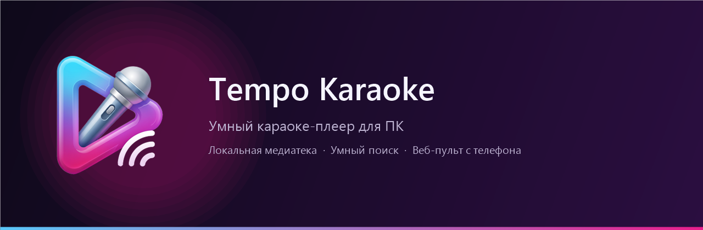

English | [Русский](README.ru.md)

# 🎤 Tempo Karaoke — a karaoke player with smart search

[](https://microsoft.com)
[](https://dotnet.microsoft.com/)
[](https://learn.microsoft.com/windows/apps/winui/winui3/)
[](LICENSE)

A modern, native video karaoke player for Windows that works with any local media library. It combines a customizable playback queue and instant search with phone-based control through a built-in web remote.

* Stack: **WinUI 3 (Windows App SDK, .NET) + LibVLCSharp + SQLite**
* Website: [Tempo Karaoke](https://itsbuyru-bit.github.io/Tempo-Karaoke/)
* Architecture and UX: [`docs/en/UX-DECISIONS.md`](docs/en/UX-DECISIONS.md)
* Build and packaging: [`docs/en/PACKAGING.md`](docs/en/PACKAGING.md)
* Window, DPI and startup: [`docs/en/WINDOW-PLACEMENT.md`](docs/en/WINDOW-PLACEMENT.md)
* What's new: [`CHANGELOG.md`](CHANGELOG.md)
* Complete feature guide: [`docs/en/FEATURES.md`](docs/en/FEATURES.md)
* Localization guide: [`docs/en/LOCALIZATION.md`](docs/en/LOCALIZATION.md)



---

## 📑 Table of Contents

- [About the Project](#-about-the-project)
- [Key Features](#-key-features)
- [Application Architecture](#-application-architecture)
- [Building and Running](#-building-and-running)
- [Initial Setup](#-initial-setup)
- [Localization (i18n)](#-localization-i18n)
- [Contributing](#-contributing)
- [License](#-license)

---

## 📌 About the Project

Tempo Karaoke is built for karaoke nights at home, in a venue, or at an off-site event.

The real value here isn't just file playback. It's **a catalogue that's a pleasure to browse, search that answers instantly, and a queue everyone can manage together**. No more crowding around a single monitor or passing the mouse back and forth:
* Video plays on your main monitor, TV, or projector — including a detached-window mode.
* Guests and the host search for songs and control playback from their own phones, right in the browser.

> ℹ️ **Note**: This repository ships the player and its supporting services only. No media library is included — the app indexes any local video files you already have.

---

## ✨ Key Features

* 🎬 **Video playback**: `.mkv`, `.mp4` and other formats through the LibVLC engine, with hardware decoding and embedded subtitles/lyrics.
* 📁 **Local media library**:
  * Scans any folders you point it at.
  * Fast SQLite cache (`media.db`) keyed on file `mtime` and size, so later launches start instantly.
  * Automatic metadata extraction (resolution, duration, artwork).
* 🔍 **Smart search as you type**:
  * Answers in under a frame, thanks to the in-memory index.
  * Strips titles of technical noise, tags, and quality markers.
  * Two-way transliteration (RU ↔ EN) plus automatic fixes for the wrong keyboard layout.
  * Tolerant of typos (fuzzy matching), ranked by relevance.
  * Duplicates and alternate versions of the same song are grouped into a single card automatically.
* 📋 **Queue and playlists**:
  * The queue survives app restarts.
  * Drag-and-drop reordering and a smooth transition to the next track.
  * Named lists, plus playlist import and export in **M3U/M3U8** format.
* 🖥 **Display modes**:
  * Full-screen mode.
  * Detach the video stream into its own window for a second monitor, projector, or TV, while the controls stay on the main screen.
* 📱 **Web remote on your phone**:
  * Built-in HTTP/WebSocket server: connect by scanning a QR code, with nothing to install.
  * Works over your local Wi-Fi network or through Wi-Fi Direct (a direct connection with no router).
  * Separate roles:
    * **Guest**: search the catalogue, see what's coming up, and request tracks.
    * **Host**: sign in with a 4-digit PIN for full transport control (play, pause, stop, volume, skip), plus queue moderation and reordering.
    * Requester names are shown next to each queued track.
* 🔐 **Persistent PIN**: in Settings you can replace the random host and administrator PINs with permanent ones. Only the salt and the PBKDF2 hash are stored.
* 🧾 **Diagnostics**: rotating logs, and a ZIP error report with system information and private data masked.
* 📶 **Safe Wi-Fi Direct**: active Wi-Fi checks, an explicit state machine, serialized operations, and a safe-by-default mode.

---

## 🏗 Application Architecture

    WinUI 3 (Windows App SDK, .NET)
    ├── UI: Catalogue, smart search, queue, full-screen and detached modes
    ├── Core: Folder scanner, title normalizer, in-memory search index
    ├── Storage: SQLite (media cache, playlists, history, sessions)
    ├── Remote: Built-in web remote server (WebSockets / HTTP)
    └── Playback: LibVLCSharp.WinUI -> libvlc

### Data storage

User data lives in the app's data folder (`%LocalAppData%\TempoKaraoke` for the portable build, or `LocalState` for the MSIX package):
* `media.db` — SQLite database holding indexed file properties and artwork paths.
* `settings.json` — app settings (theme, media library paths, remote behaviour).
* `queue.json` — the saved queue, with tracks attributed to whoever requested them.
* `playlists.json` — user playlists.
* `remote-clients.json` — cache of authorized devices.
* `logs/` — rotating application logs, plus logs from the Wi-Fi Direct helper.
* `Reports/` — ZIP error reports created by the user.
* `settings.json` also contains a `Security` block with the salt and hash of the persistent PINs
  (the PIN itself is never stored).

---

## 🚀 Building and Running

### Requirements
* Windows 10 (build 19041+) or Windows 11
* .NET SDK 10
* No separate VLC installation is needed: `libvlc` comes in with the `VideoLAN.LibVLC.Windows` NuGet package
* Visual Studio with the Windows App SDK / WinUI 3 components, or the WinApp CLI

### Running through the WinApp CLI
    winapp run src/TempoKaraoke --arch x64

### Building the solution and running tests
    dotnet build TempoKaraoke.slnx -c Debug
    dotnet test tests/TempoKaraoke.Tests/TempoKaraoke.Tests.csproj

### Publishing a Release build
    dotnet publish src/TempoKaraoke -c Release -p:Platform=x64 -p:RuntimeIdentifier=win-x64

### Packaging scripts
* `.\scripts\build-installer.ps1` — build the classic installer with Inno Setup
* `.\scripts\make-cert.ps1` — generate a local development certificate
* `.\scripts\build-msix.ps1 -Mode sideload` — produce a signed MSIX package
* `.\scripts\install-msix.cmd` — install the MSIX package on your machine in one step

The full process is described in [`docs/en/PACKAGING.md`](docs/en/PACKAGING.md).

---

## 🛠 Initial Setup

1. **Add folders**: open **Video library**, or go to **Settings**, click **Add folder**, and pick the directories holding your video files. The scanner builds the catalogue and caches it for you.
2. **Turn on the remote**: open **Web remote**. A QR code and the local server address appear on screen.
3. **Connect devices**: join the phone to the same Wi-Fi network (or to the PC's Wi-Fi Direct network) and scan the code.

---

## 🌍 Localization (i18n)

Both the desktop interface and the web remote are multilingual. Translations come from a
single source: the `localization/` folder, with `manifest.json` and flat JSON catalogues:

```text
localization/manifest.json   ← the only list of supported languages
localization/en-US.json      ← base and fallback locale
localization/ru-RU.json
```

These generate the desktop resources `Strings/<tag>/Resources.resw` and the web files
`public/locales/<tag>.json`:

```powershell
node scripts/localization/generate.mjs
```

Adding a language takes one new file and one entry in `manifest.json` — no changes to C# code
or to the language selector. On first launch the app picks the Windows language (if the manifest
lists it); a manual choice is saved to `settings.json`. Missing keys fall back to `en-US`
automatically. The web remote uses the same tags and populates its selector dynamically from
`/locale-manifest.json`.

For details, see [`docs/en/LOCALIZATION.md`](docs/en/LOCALIZATION.md).

---

## 📝 Diagnostics, Logs and Reports

* Logs: `%LocalAppData%\TempoKaraoke\logs\` (portable) or `LocalState\logs\`
  (MSIX). The main log rotates at 5 MB and keeps 5 files.
* Entries record the version, OS, architecture, language, Wi-Fi adapter and connection
  state, Wi-Fi Direct steps, exceptions with `HRESULT`, and operation identifiers.
* Crashes (`AppDomain`, `TaskScheduler`, WinUI) are always logged, even when regular
  logging is switched off.
* **Settings → Diagnostics → Error report** assembles a ZIP with logs, system
  information, sanitized settings, and localization state. Media file paths, PINs,
  SSIDs, and MAC addresses are masked.
* The report contains no mini dump; after a BSOD, use the system
  `%SystemRoot%\Minidump` folder.

For details, see [`docs/en/DIAGNOSTICS.md`](docs/en/DIAGNOSTICS.md).

---

## 🔒 Remote Security

* The host and administrator PINs are random by default and regenerated for every session.
* Under **Settings → Security** you can switch to a persistent PIN (4–8 digits).
  Only the salt and the PBKDF2-SHA256 hash are stored (100,000 iterations) — never the PIN itself.
* After 5 failed attempts the role is locked for 5 minutes; the log records only the
  fact of the failure, the role, and the attempt number.

For details, see [`docs/en/PIN-SECURITY.md`](docs/en/PIN-SECURITY.md).

---

## 📶 Wi-Fi Direct and the BSOD Risk

Wi-Fi Direct runs in a separate helper process. Before starting it, the app checks the
adapter and the active Wi-Fi connection, serializes all operations, and follows an
explicit state machine. **Safe mode** (on by default) blocks Wi-Fi Direct while the PC
is connected to Wi-Fi; with safe mode off, the app warns about the risk of a driver
conflict.

Kernel-level faults (`IRQL_NOT_LESS_OR_EQUAL`, `0xA`) cannot be fixed by the app:
if they keep occurring, update your Wi-Fi driver, BIOS/UEFI, and Windows. For the full
description, limitations, and checklist, see [`docs/en/WIFI-DIRECT.md`](docs/en/WIFI-DIRECT.md).

---

## 🤝 Contributing

Pull requests are welcome! If you want to fix a bug, suggest a search algorithm improvement, or add a feature:

See [CONTRIBUTING.md](CONTRIBUTING.md) for build/test commands, code style and the release process.

1. **Fork** the project.
2. Create a feature branch:
       git checkout -b feature/awesome-feature
3. Commit your changes:
       git commit -m "Add: brief description of changes"
4. Push the branch to your fork:
       git push origin feature/awesome-feature
5. Open a **Pull Request**.

---

## 📄 License

The project is distributed under the [MIT](LICENSE) license. Playback components use the VideoLAN project libraries in accordance with the terms of the LGPL-2.1 license.
